# Dicey Depths

A dice roguelike for the **Pebble Time 2** and **Pebble Round 2**.

<p align="center">
  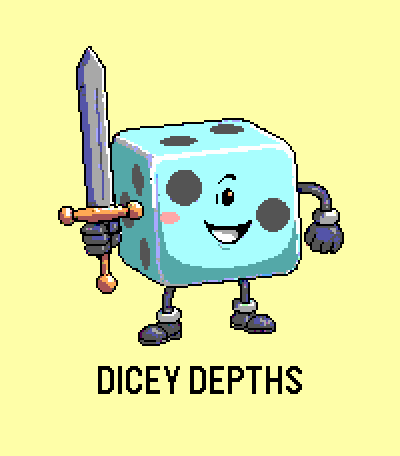
  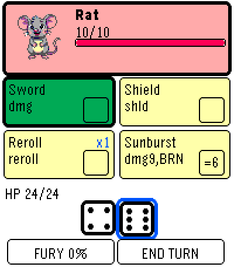
  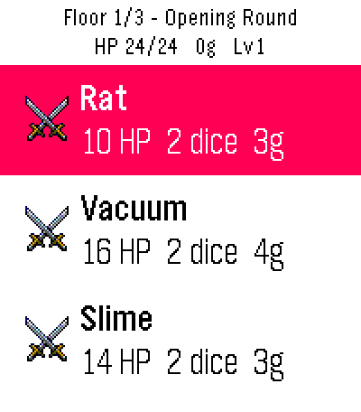
</p>

You are a walking six-sided die on a game show. Every turn you roll your dice **face up**,
and then decide how to spend them across the equipment you brought in. You always see the
randomness before you commit, which turns a bad roll into a puzzle rather than a punishment.

Inspired by [*Dicey Dungeons*](https://terrycavanagh.itch.io/dicey-dungeons) by Terry
Cavanagh. This is an original implementation for Pebble — no code or assets came from that
game.

---

## How it plays

**Drag** a die onto a card. Or **tap** a die and then tap a card. Or use the **buttons** —
Up/Down to move, Select to pick a die up and Select again to drop it.

Each card accepts a die that matches its slot: *any*, *odd*, *even*, *4+*, *3-*, or an exact
number, shown in the little box on the card. **A card fires once per turn**, so a spare die
is worth nothing without a card to put it in — filling your slots is most of the build.

Fussy cards pay better. A card that only takes a `1` hits far harder than one that takes
anything, and is dead weight on the turn you don't roll one. Some cards take any die and pay
out normally, but do something **extra on a six**.

Hold Select, or tap the enemy, to see exactly what it is carrying. Nothing it does should
ever be a surprise — only a problem.

<p align="center">
  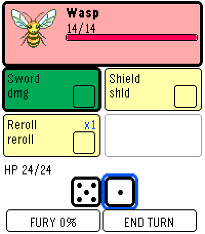
  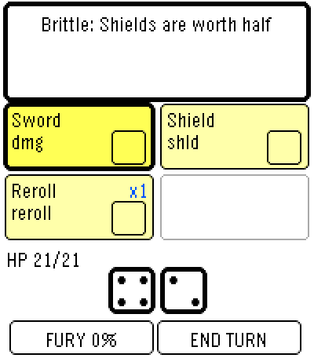
</p>

## Two classes

<p align="center">
  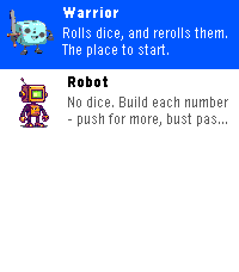
  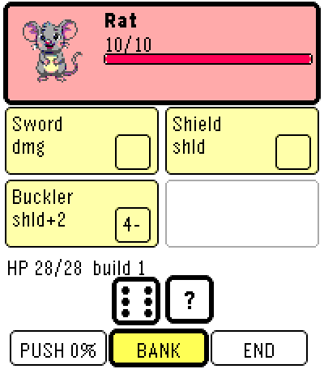
</p>

Each class is a different answer to one question: how does uncertainty enter a turn?

- **The Warrior** rolls dice and rerolls them. A Reroll card turns a die you can't use into
  one you can, and its allowance grows with the size of your handful.
- **The Robot** has **no dice at all**. It *builds* each number: PUSH adds to a CPU meter,
  BANK locks it in, and going past six loses the lot. Aiming for the exact number a card
  wants is this class's whole game.

## Statuses attack your rolls, not your health

Every status bar one is a dice puzzle rather than a subtraction.

| | |
|---|---|
| **Burn** | a die catches fire — 2 HP to put it out |
| **Frozen** | your best die becomes a 1 |
| **Shocked** | a card goes offline — drop any die on it to clear |
| **Weakened** | one card does half |
| **Blind** | dice hidden until spent |
| **Poison** | 3 HP a turn, straight through shields |
| **Fury** | your next card fires twice |
| **Silence** | no Limit Break |

## Modes

**Campaign** — five episodes, three floors each. Each is a *ruleset* that rewrites the game
rather than a difficulty step, and each ends in its own boss.

1. **Opening Round** — standard rules
2. **Curse of Greed** — start with upgraded weapons, take a curse every turn
3. **Parallel Universe** — Frozen drops every die by 1; Burn is usable but jams the card; Poison infects a card
4. **Elimination Round** — lose a piece of equipment after every fight
5. **Sudden Death** — less health, an extra die, double the gold

Clear all five and three **Bonus Rounds** open up.

**Endless** — no boss. Enemies get tougher with depth and from floor 4 each floor draws one
of the campaign rulesets at random. Your ten best runs are kept on the watch.

**Three difficulties.** Easy is very hard to lose. Hard adds a named curse to every floor —
Fever, Toxic Air, Crowded, Brittle, Lean Pickings, Static. Episode clears are tracked per
difficulty, so a finished campaign still has somewhere to go.

<p align="center">
  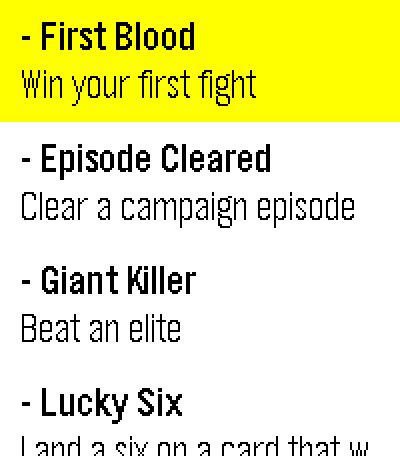
  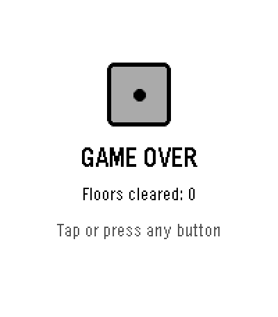
</p>

Lose a fight and the run is over.

## Both shapes of watch

<p align="center">
  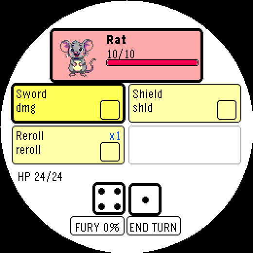
  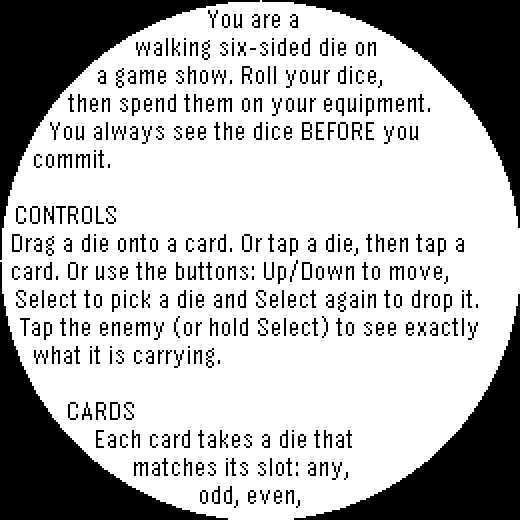
</p>

The two target platforms are the only Pebbles with a touchscreen, and they are very different
shapes: `emery` (Time 2) is a 200x228 rectangle and `gabbro` (Round 2) is a 260x260 **circle**.
Nothing in the layout assumes a rectangle — every band is measured against the chord of the
circle at that height, and scrolling text flows to the curve of the glass.

Sound is Time 2 only; Round 2 has no speaker, so nothing the game plays carries information
that isn't already on the screen.

## Building

```bash
pebble build
pebble install --emulator emery     # or gabbro
```

Needs the Pebble SDK (4.33.1) and `pebble-tool`. Art is generated against the hardware's
64-colour palette and verified by `tools/verify_art.py`; `tools/check_data.py` validates the
game tables; `tools/simulate.py` plays thousands of runs to tune difficulty.

See [CLAUDE.md](CLAUDE.md) for architecture, conventions and the traps this codebase has
already fallen into.

## Credits

Inspired by *Dicey Dungeons* by **Terry Cavanagh**, with art by **Marlowe Dobbe** and music
by **Chipzel**. Built by Nathan Marchant.
